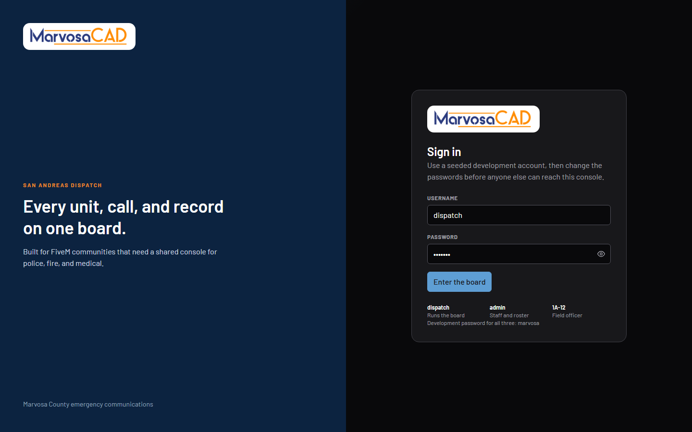
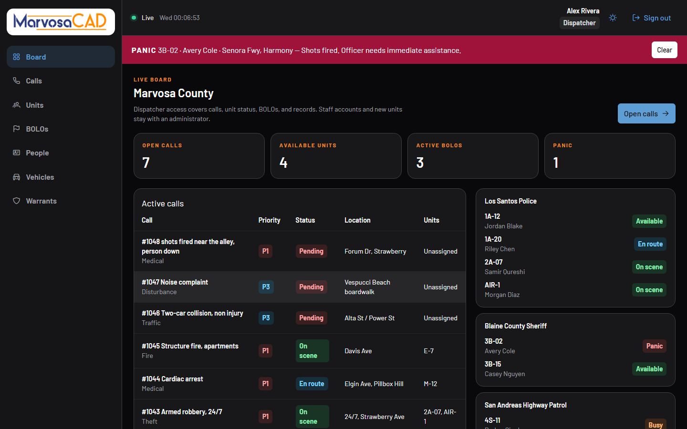
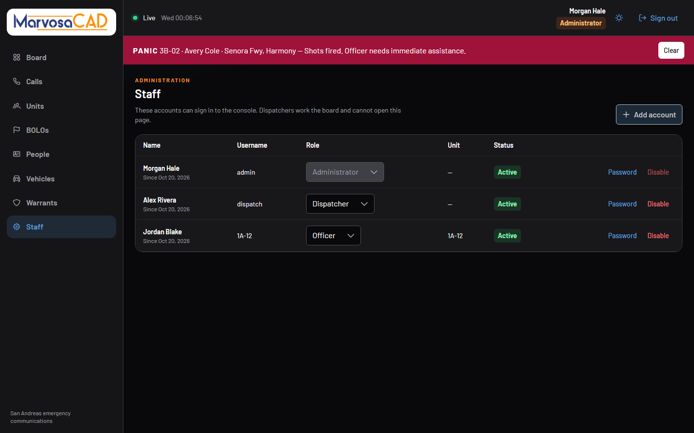
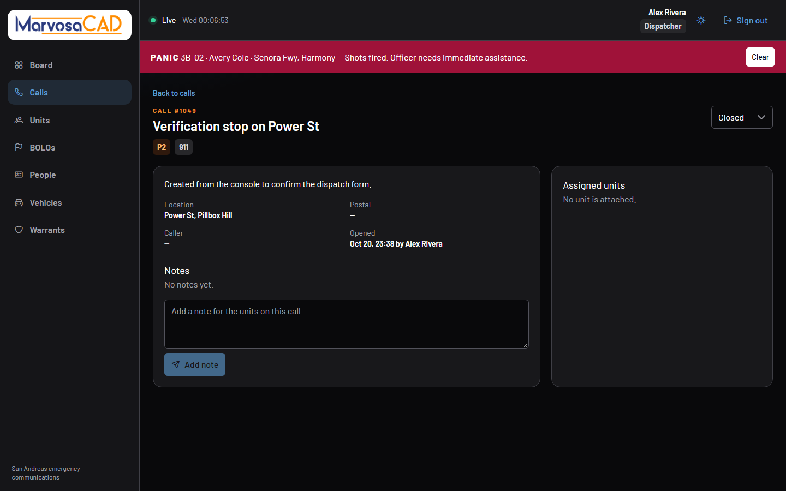
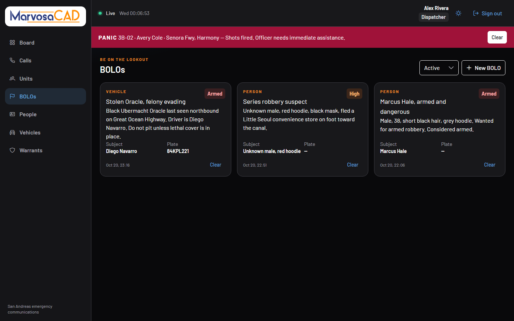
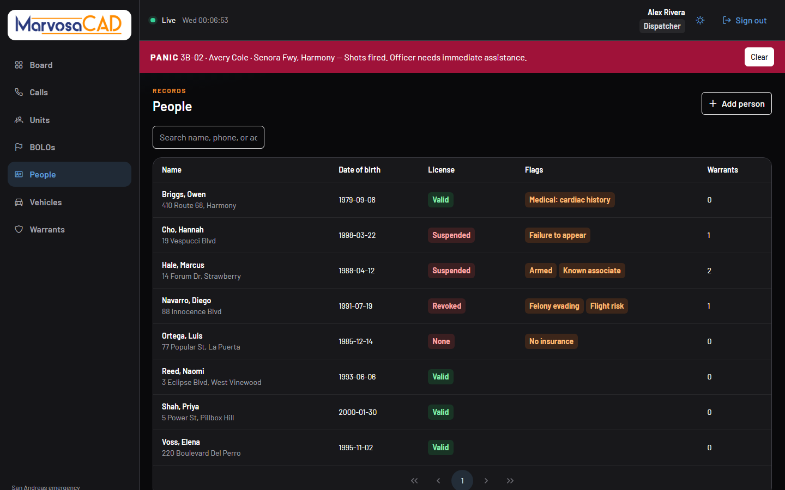
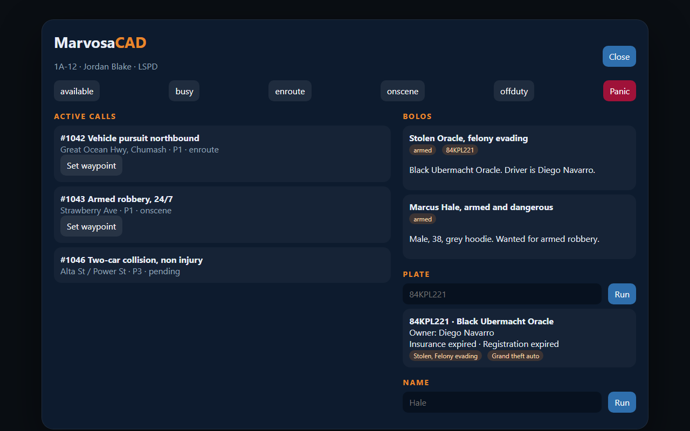

# MarvosaCAD

MarvosaCAD is a dispatch console for a FiveM server. Dispatchers work in a browser. Officers, medics, and firefighters send calls, status, panic, and plate lookups from an in-game mobile data terminal.

The console is Angular 22 with Optimus UI and Tailwind CSS. The API is NestJS 12 with SQLite. The game connection is a standalone FiveM resource.

## Screenshots

Sign in with a seeded development account. The password field is already filled for the local demo.



The board shows open calls, unit status, BOLOs, and an active panic. A dispatcher sees that note under the county name, and the sidebar stops at warrants.



An administrator keeps the same board and also gets Staff. That page creates accounts, changes roles, resets passwords, and disables sign-in. The API rejects those requests from a dispatcher.



Each call keeps its location, assigned units, and notes.



BOLOs sit beside the call board.



People, vehicles, and warrants are searchable from the same console.



In game, `/mdt` or F6 opens the terminal. This is the same panel with sample data, so it can be previewed without launching FiveM.



## Requirements

- Node.js **22.22.3 or newer**, **24.15 or newer**, or **26**. Angular 22 will not start on older Node 22 releases.
- npm 10 or newer, which ships with that Node version.
- A FiveM server only if you want the in-game resource. The console and API run on their own.

## 1. Start the API

From the `api` folder:

```bash
cd api
npm install
copy .env.example .env
npm run db:setup
npm run start:dev
```

On macOS or Linux, use `cp .env.example .env` instead of `copy`.

`db:setup` creates `api/prisma/dev.db` and loads the Marvosa County demo: units, calls, BOLOs, people, vehicles, and warrants. The API listens on [http://localhost:3000/api](http://localhost:3000/api).

Check it with:

```bash
curl http://localhost:3000/api/health
```

A healthy API returns `{"status":"ok","service":"marvosa-cad"}`.

## 2. Start the console

In a second terminal, from the `web` folder:

```bash
cd web
npm install
npm start
```

Open [http://localhost:4200](http://localhost:4200). If the API is not on this machine, edit `web/public/config.json` before you sign in:

```json
{
  "apiUrl": "http://YOUR-SERVER:3000/api",
  "wsUrl": "http://YOUR-SERVER:3000"
}
```

The console reads that file on startup, so a rebuild is not required after an address change.

## 3. Sign in

These accounts exist only after `npm run db:setup`. Change them before anyone else can reach the API.

| Username | Password | Role | What they can do |
| --- | --- | --- | --- |
| `dispatch` | `marvosa` | Dispatcher | Work calls, change unit status, write BOLOs, and edit records |
| `admin` | `marvosa` | Administrator | Everything a dispatcher can do, plus staff accounts and adding units |
| `1A-12` | `marvosa` | Officer | The same board as a dispatcher, attached to unit 1A-12 |

The sign-in form starts on the dispatcher account. Sign in as `admin` to open **Staff** in the sidebar. A dispatcher who opens `/staff` is sent back to the board, and `POST /api/users` returns 403.

## 4. Connect FiveM

Copy `fivem/marvosa-cad` into your server's `resources` folder. In `server.cfg`:

```cfg
ensure marvosa-cad
set marvosa_api_url "http://127.0.0.1:3000/api"
set marvosa_api_key "marvosa-dev-key"
```

Use the LAN address of the computer running the API when the game server is on another machine, for example `http://192.168.1.20:3000/api`. The API key must match `FIVEM_API_KEY` in `api/.env`.

`127.0.0.1` is correct when FXServer and the API are on the same computer. The API binds to all interfaces, so other machines on the network can reach it once the URL and firewall allow it.

Players then have:

| Command | What it does |
| --- | --- |
| `/911 [message]` | Opens a call at the player's street and zone |
| `/mdt` or `F6` | Opens the mobile data terminal |
| `/callsign 1A-12` | Sets the unit call sign, remembered on that client |
| `/department LSPD` | Sets the department: `LSPD`, `BCSO`, `SAHP`, `LSFD`, or `EMS` |
| `/status available` | Sets status: `available`, `busy`, `enroute`, `onscene`, `offduty`, or `panic` |
| `/panic` | Sends a panic alert with the current street |
| `/plate 84KPL221` | Reads the plate back in chat |

The terminal can attach a waypoint to a call that has game coordinates, run a plate, and search a name. A player who leaves the server is marked off duty.

`/911` picks a type and priority from the message. Shots, injuries, and medical words become a priority 1 medical call. Fire, smoke, or an explosion becomes a priority 1 fire call. A pursuit is priority 1. Theft is priority 2. A noise or music complaint is priority 3. Anything else is a priority 2 911 call. Dispatch can change the type, priority, and status after it arrives.

Shared options that are not secrets live in `fivem/marvosa-cad/config.lua`: the location heartbeat interval (20 seconds) and the default department.

## What the console covers

- Calls, with assignment, notes, and close
- Units across LSPD, BCSO, SAHP, LSFD, and EMS. Dispatchers change status. Administrators add units.
- Staff accounts, roles, passwords, and disabled sign-in, for administrators only
- BOLOs for people and vehicles
- People, vehicles, plates, and warrants
- Panic alerts, shown as a banner until someone clears them
- A live connection so a 911 from the game appears without refreshing

## Before you put this on a real server

The values in `api/.env` are for a local demo:

- `JWT_SECRET` signs dispatcher sessions. Replace it.
- `FIVEM_API_KEY` is the only credential the game resource sends. Replace it in both `.env` and `server.cfg`.
- The seeded password is `marvosa`. Reset the database with `npm run db:reset` only if you are willing to wipe the demo data, then change the accounts in `api/prisma/seed.ts` before seeding again.

Keep the API off the public internet unless it is behind HTTPS and a firewall. SQLite is the right database for one community on one machine. The file is `api/prisma/dev.db`.

## Project layout

| Path | Role |
| --- | --- |
| `web/` | Angular console |
| `api/` | NestJS API |
| `fivem/marvosa-cad/` | FiveM resource |

From `api`, `npm test` checks call classification. `npm run build` compiles the API. From `web`, `npm run build` compiles the console.
